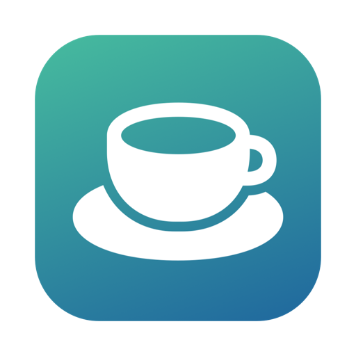

# Recess

**A free, open-source break reminder for Mac and Windows.** Recess dims your screen when it's time to rest your eyes, stretch or get up. You can postpone or skip when you're in the middle of something, and it notices when you've already stepped away.

**[Download for Mac](https://github.com/NeelkanthTandel/recess/releases/latest/download/Recess.dmg)** · **[Download for Windows](https://github.com/NeelkanthTandel/recess/releases/latest/download/Recess-Setup.exe)** · [Website](https://recess.always17.com/)

macOS 14+ (Apple Silicon and Intel) · Windows 10 (2004) or 11, 64-bit

[](https://github.com/NeelkanthTandel/recess/actions/workflows/ci.yml)
[](LICENSE)

## Features

- **As many breaks as you like.** It starts with a 10-minute *Normal* break every hour and a 15-second *Micro* break every 15 minutes.
- **Flexible timing.** The next break can be timed from when the last one was due, from when it ended, at a set minute each hour, or from your calendar events. Breaks can be limited to certain hours (including overnight windows) and days of the week.
- **Notices when you're away.** Time away from the keyboard counts as a break, and so does sleep or a locked screen. Each break chooses whether its clock keeps running, stops or winds back while you're away.
- **Priorities.** Breaks higher in the list win; a smaller break steps aside when a bigger one is about to start.
- **Gentle or strict.** A break can start right away, wait for a pause in your typing, or ask first. On the break screen you can postpone (two buttons), skip, end early, or require a click to finish. You can even lock the computer into the break.
- **Postpone & skip limits.** Allow only N postpones or skips per break, hour or day. The limits apply everywhere: break screen, menu, shortcuts and links.
- **Themes.** A countdown ring, a breathing guide, clocks, eye-rest and desk-stretch routines, or your own text, website, YouTube video or photo folder.
- **Actions** before, during and after breaks: notifications, sounds, speech, a screen flash, or your own scripts (AppleScript and shell on the Mac, PowerShell and batch files on Windows).
- **Rules.** Postpone or skip breaks while a given app is in front or open, during a fullscreen app, a call (Windows), Focus (Mac), the screensaver or a calendar event, or whenever a script you write says so.
- **Always at hand.** A menu bar item (Mac) or notification-area icon (Windows) with a countdown and every command, **global keyboard shortcuts**, and **`recess://` links** for automation.
- **Activity.** A log of breaks taken, postponed and skipped, a statistics chart, and an optional per-app usage timeline.
- **Private.** No accounts, analytics or update checks; your settings are plain JSON on your computer.

## Install on a Mac

1. Download **[Recess.dmg](https://github.com/NeelkanthTandel/recess/releases/latest/download/Recess.dmg)** from the [latest release](https://github.com/NeelkanthTandel/recess/releases/latest).
2. Open it and drag **Recess** into **Applications**.

Requires macOS 14 Sonoma or later, on Apple Silicon or Intel.

### First launch

Recess isn't notarized by Apple yet, so the first time you open it macOS says it can't verify the app. You only need to allow it once:

1. Open Recess. When macOS says it can't verify it, click **Done**.
2. Open **System Settings › Privacy & Security**, scroll down to **Security**, and click **Open Anyway** next to Recess.
3. Confirm with your password or Touch ID, then click **Open**.

Or, in Terminal: `xattr -dr com.apple.quarantine /Applications/Recess.app`

### Permissions (all optional)

| Permission | Used for |
| --- | --- |
| Notifications | "Break coming up" warnings. Without it, Recess shows its own banner. |
| Calendars | Calendar-timed breaks and "during a meeting" rules |
| Accessibility | Only for the *Input monitoring* idle detector (the default needs nothing) |
| Full Disk Access | Only for Focus rules, which read macOS's Do Not Disturb state. Read [SECURITY.md](SECURITY.md) before granting it. |

## Install on Windows

1. Download **[Recess-Setup.exe](https://github.com/NeelkanthTandel/recess/releases/latest/download/Recess-Setup.exe)** from the [latest release](https://github.com/NeelkanthTandel/recess/releases/latest) and run it. It installs for your account only, with no admin rights needed.
2. Recess opens with a short setup assistant, then lives in the notification area by the clock. Windows may tuck new icons under the **^** arrow; to keep it in view, turn Recess on under **Settings › Personalization › Taskbar › Other system tray icons**.

Requires Windows 10 version 2004 or Windows 11, 64-bit; it also runs on Windows on Arm. Prefer not to install? **[Recess-windows.zip](https://github.com/NeelkanthTandel/recess/releases/latest/download/Recess-windows.zip)** is a portable copy: unzip it anywhere and run `Recess.exe`.

### First launch

Recess isn't code-signed yet, so the first time you run it Windows may say **Windows protected your PC**. Click **More info**, then **Run anyway**. You only need to do this once. On a new PC with **Smart App Control** turned on, Windows won't run unsigned apps at all; that will change once releases are signed.

### How Windows differs

- **Calendars** come from your calendar's private iCal address (Google Calendar, Outlook.com, iCloud and Exchange all offer one) or an `.ics` file, added under **Settings › General › Calendars**. Downloading it is the only time Recess goes online. The address is stored encrypted for your Windows account.
- **Calls:** a *Microphone or camera in use* rule postpones breaks while you're in a call, in any app or browser.
- **Do not disturb** can't be read by apps on Windows, so that rule condition doesn't match there.
- The tray icon shows the **minutes to your next break** (tray icons can't show text beside them); its tooltip shows the rest.

## Checking your download

Each release lists the SHA-256 checksum of every file. On a Mac: `shasum -a 256 Recess.dmg`. On Windows, in PowerShell: `Get-FileHash Recess-Setup.exe`.

## Build from source

**Mac**, with Xcode 16 or later:

```bash
git clone https://github.com/NeelkanthTandel/recess.git
cd recess
make install        # builds a release app, copies it to ~/Applications and opens it
```

**Windows**, with the [.NET 10 SDK](https://dotnet.microsoft.com/download):

```powershell
git clone https://github.com/NeelkanthTandel/recess.git
cd recess\windows
dotnet run --project src/Recess.App -c Release
```

## Automation

```text
recess://start                     start the next break (or ?break=Micro)
recess://postpone?minutes=5        postpone the current or next break
recess://skip                      skip the current or next break
recess://makedue?break=Normal&seconds=30
recess://pause?minutes=30          pause all breaks (omit minutes for "until resumed")
recess://resume   recess://reset   recess://stopsound   recess://settings
```

You can turn these off under **Settings › Advanced**.

Scripts for actions and rules live in `~/Library/Application Support/Recess/Scripts` on a Mac and `%APPDATA%\Recess\Scripts` on Windows. The samples there show how to check whether you're in a call.

## Contributing

Contributions are welcome! See [CONTRIBUTING.md](CONTRIBUTING.md) for setup, and [docs/ARCHITECTURE.md](docs/ARCHITECTURE.md) for how the apps fit together. Please report security issues privately as described in [SECURITY.md](SECURITY.md).

## License

[MIT](LICENSE).
